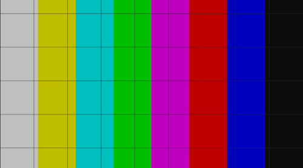

# Display and touch for a Scion AVF VM

**Status: works on the Pixel 10.** A Linux guest's framebuffer shows in a
SurfaceView in our sideloaded app at the panel's 120 Hz, and touches reach
the guest's evdev. Neither path uses crosvm's virtio-gpu display, which is
closed to a sideloaded app on this build.

Sources are marked like this:

* **[src]**: AOSP `packages/modules/Virtualization` and `system/sepolicy` at
  `android17-release` (April 2026), and crosvm at the same branch;
* **[pixel]**: measured on the Pixel 10 (`frankel`, Android 17 / SDK 37,
  `DP11.260918.006`, user build) with `display/run-on-device.sh`.

## 1. Short answer

| Mechanism | What it is | Sideloaded app on the Pixel 10 |
|---|---|---|
| **Stock display**: `setDisplayConfig` (+ `setGpuConfig`) | crosvm gets `--gpu=...displays=[[mode=windowed[w,h],...]]` and `--android-display-service=<name>`, registers an `ICrosvmAndroidDisplayService` with virtualizationservice, and the Terminal app fetches it and hands it a `Surface` | **No, for two reasons.** (1) [pixel] This build's crosvm has no Android display backend: `crosvm: arg parsing failed: Unrecognized argument: --android-display-service`, so **a VM with a `DisplayConfig` doesn't start at all**. (2) [src, pixel] Even with it, SELinux lets only the Terminal priv-app (`vmlauncher_app`) look up `virtualizationservice` and exchange binders with crosvm. From our app's domain, `service check android.system.virtualizationservice` says `not found` |
| **Stock touch**: `useTouch(true)` + `VirtualMachine.sendMultiTouchEvent` | the framework makes a socketpair, passes one end to crosvm as `--input multi-touch[path=...,width,height]`, and writes `input_event`s into the other | **Not as shipped.** The framework only attaches input devices when the config has a `DisplayConfig` (`createVirtualMachineConfigForRawFrom`), which kills the VM (above) |
| **Touch, added to the raw config** | the same `InputDevice.MultiTouch` + socketpair, put into `VirtualMachineRawConfig.inputDevices` by the app | **Yes** [pixel]. crosvm creates a virtio-input multi-touch device; the guest sees `scion-touch`, `ABS_MT_POSITION_X 0..W`, `Y 0..H` |
| **Shared-memory framebuffer** (SCFB): `VirtualMachineRawConfig.customMemoryBackingFiles` | an ashmem region of ours becomes a slice of guest RAM (`--file-backed-mapping ...,rw,ram`); the guest draws there, the app copies to its SurfaceView | **Yes** [pixel]. Zero copies in the guest→host direction, and one `memcpy` into the buffer queue |

Both working paths need fields the Java API never fills
(`customMemoryBackingFiles`, and `inputDevices` without a display). The app
adds them by wrapping the `IVirtualizationService` binder that
`VirtualMachine.run()` uses, so that `createVm()` sees a patched config
(section 4). Everything else stays the stock Java path: console capture,
callbacks, `stop()`. virtmgr passes both fields straight to crosvm.

So for Scion:

* **Display = SCFB** ([display/SCFB.md](../display/SCFB.md)): the AVF
  equivalent of the `ramfb` that HackiOS already draws into. The XNU side is
  small: avfboot points boot_args' video at the region, and
  MiniIOMobileFramebuffer publishes each frame (hackios-xnu-kernel,
  `avf/display`).
* **Touch = virtio-input multi-touch** added to the raw config, driven by the
  app's own evdev writer (same wire format as the framework's).
* virtio-gpu 2D stays an optional XNU path, for QEMU/crosvm hosts that do
  scan out, and as the base the 3D work builds on. On this phone it can't
  reach the screen.

## 2. What the custom-image config offers [src]

All of these are `@hide` and need the hidden-API exemption (section 5).

* `VirtualMachineCustomImageConfig.DisplayConfig.Builder`: `setWidth`,
  `setHeight`, `setHorizontalDpi`, `setVerticalDpi`, `setRefreshRate`.
  virtmgr requires all five to be non-zero.
* `GpuConfig.Builder`: `setBackend` (`2d`, `virglrenderer`, `gfxstream`),
  `setContextTypes`, `setPciAddress`, `setRendererFeatures`,
  `setRendererUse{Egl,Gles,Glx,Surfaceless,Vulkan}`. The Terminal app sets
  gfxstream + Vulkan when it's enabled.
* `Builder.useTouch/useKeyboard/useMouse/useTrackpad/useSwitches(boolean)`:
  attached only together with a `DisplayConfig`.
* `AudioConfig` (`setUseSpeaker`, `setUseMicrophone`): virtio-snd with the
  `aaudio` backend. `UsbConfig`: xHCI.
* `VirtualMachine`: `sendMultiTouchEvent(MotionEvent)` (queued; x/y multiplied
  by `setTouchScale`), `sendKeyEvent(short evdevCode, boolean down)`,
  `sendMouseEvent`, `sendTrackpadEvent`, `sendLidEvent`, `sendTabletModeEvent`,
  and new in 17, `addDisplay/removeDisplay/getDisplays` (display hot-plug over
  crosvm's control socket).
* virtmgr honours GPU, display and input only when it was built with
  `RELEASE_AVF_SUPPORT_CUSTOM_VM_WITH_PARAVIRTUALIZED_DEVICES`. On the Pixel
  it was [pixel]: virtmgr passed `--gpu`, `--input` and
  `--android-display-service` on to crosvm. It's crosvm that lacks the display
  backend.

## 3. Why the stock display path is closed [src, pixel]

From `system/sepolicy`, inside `is_flag_enabled(RELEASE_AVF_SUPPORT_CUSTOM_VM_WITH_PARAVIRTUALIZED_DEVICES)`:

```
# private/vmlauncher_app.te
allow vmlauncher_app virtualization_service:service_manager find;
allow vmlauncher_app virtualizationservice:binder call;
allow vmlauncher_app crosvm_domain:binder { call transfer };
# private/crosvm.te
allow crosvm_domain vmlauncher_app:binder { transfer call };
```

`untrusted_app_all` has only `virtualizationservice_use(untrusted_app_all)`,
which covers the sockets, fds and pipes between client, virtmgr and crosvm, not
these binder edges. So a sideloaded app:

1. can't find `android.system.virtualizationservice` [pixel: `run-as <pkg>
   service check` says `not found`, and `ServiceManager.checkService` returns
   null in the app], so `waitDisplayService()` is out of reach;
2. couldn't call `setSurface()` on crosvm (`untrusted_app → crosvm_domain`
   binder call);
3. couldn't receive crosvm's buffers in its `BLASTBufferQueue`
   (`crosvm_domain → untrusted_app`).

On top of that, this build's crosvm rejects `--android-display-service`
[pixel], so even the Terminal app's GUI path isn't there in this crosvm. No
hidden-API exemption changes any of this.

## 4. Shared memory and the createVm hook

[src] `CustomMemoryBackingFile {ParcelFileDescriptor file; long rangeStart;
long size}` becomes `--file-backed-mapping /proc/self/fd/N,addr=..,size=..,rw,ram`.
crosvm dups the fd (`open_file_or_duplicate`), maps it `MAP_SHARED` and backs
that part of guest RAM with it. The range must lie inside guest RAM.

SELinux: crosvm may `map` an **ashmem** fd (every domain may, `domain.te`),
but not an app's memfd (only its own) or an `app_data_file` (no `map`).
[pixel] `SharedMemory.create()` returns ashmem on this phone
(`/dev/ashmem<boot-id>`; `sys.use_memfd` is unset). The app also has a
fallback that opens the libcutils ashmem device itself, allowed while it
targets SDK ≤ 36.

The hook (`display/app/.../DisplayVm.kt`):

1. `VirtualizationService.getInstance()` (package-private): the singleton
   `VirtualMachine.run()` will use. The app keeps a strong reference so it
   stays the same instance.
2. Replace its `mBinder` with a `java.lang.reflect.Proxy` over
   `IVirtualizationService` that forwards every call. In `createVm`, it appends
   the `CustomMemoryBackingFile` and an `InputDevice.MultiTouch` (our
   socketpair, width/height = framebuffer size, name `scion-touch`) to
   `getRawConfig()`.
3. virtmgr's crosvm command line [pixel]:
   `--input multi-touch[path=/proc/self/fd/35,width=1080,height=2424,name=scion-touch]
   --file-backed-mapping /proc/self/fd/36 (/dev/ashmem...),addr=0x9dc00000,size=0x2000000,rw,ram`.

This depends on framework internals (a private field and a package-private
method) that may change between releases. The app reports which step failed
if they do.

## 5. Grants and hidden-API exemption

Grants are unchanged from spike 1: `pm grant` **MANAGE_VIRTUAL_MACHINE** and
**USE_CUSTOM_VIRTUAL_MACHINE**.

`hidden_api_blacklist_exemptions` (comma-separated signature prefixes; set by
`display/run-on-device.sh` and restored on exit):

| Prefix | For |
|---|---|
| `Landroid/system/virtualmachine/VirtualMachineCustomImageConfig` | the custom-image `Builder`, and `DisplayConfig`/`GpuConfig` builders for the stock-display experiment |
| `Landroid/system/virtualmachine/VirtualMachineConfig$Builder;->setCustomImageConfig(` | as in spike 1 |
| `Landroid/system/virtualmachine/VirtualMachine;->send` and `...;->setTouchScale(` | stock touch (only with `--stock-display`) |
| `Landroid/system/virtualmachine/VirtualizationService;` | the hook: `getInstance()`, `mBinder` |
| `Landroid/system/virtualizationservice/` | `IVirtualizationService` (proxied), `VirtualMachineConfig.getRawConfig`, `VirtualMachineRawConfig`, `CustomMemoryBackingFile`, `InputDevice` |
| `Landroid/os/ServiceManager;->checkService(` | only the stock-display reachability check |

[pixel] With this list, no `hiddenapi` denials were logged.

## 6. Pixel 10 results [pixel]

`display/run-on-device.sh` (default options): 1080×2424 guest framebuffer
(the full panel), XB24, 512 MiB guest, 1 vCPU, Debian 6.12 cloud kernel plus
`virtio_input` and `evdev` modules, and our freestanding `scfb-init`.

| | full res 1080×2424 | half res 540×1212 |
|---|---|---|
| guest RAM shared with the app | yes: the guest saw the app's pre-boot stamp (`host_pre=1`) | yes |
| first frame on screen after `run()` | 0.74 s (kernel boot included) | 0.80 s |
| guest full-frame redraw, back to back for 5 s | 162 fps (1.7 GB/s into the region) | 275 fps |
| frames the app presented in that window | 120 fps (the panel's refresh rate caps the buffer queue) | 120 fps |
| app copy per frame (`memcpy` into `ANativeWindow`) | 1.39 ms avg, 2.8 ms max | 0.37 ms |
| steady demo (guest redraws at ~60 Hz) | 59 fps, every frame presented (`host_seq` = `frame_seq` - 1) | |
| scripted touch: reports sent / reached guest evdev | 400 / 400, coordinates exact | 400 / 400 |
| scripted touch → frame showing it, posted to SurfaceFlinger: p50 / p90 / p99 | 15.6 / 20.5 / 27.2 ms | 9.2 / 12.2 / 18.1 ms |
| real touches (`adb shell input swipe`, through InputDispatcher → app → guest) → posted: p50 / p90 | 10.6 / 16.0 ms (188 reports) | 6.9 / 9.2 ms |
| BGRX (`XR24`, iOS's layout) | BGRA_8888 buffer queue accepted, plain `memcpy`, colours right | |

The latency figures run from the app handing the report to the socket, until
the app posted the guest's frame drawn after the guest had read that report
(the guest echoes its report count in the frame header). They include the
guest redrawing the full frame. That redraw is slow, at ~6 ms for 10 MB:
`/dev/mem` maps the region as Device memory for Linux, and the test renderer
is plain C. XNU draws through a write-combined mapping. What's left is the
transport, about 1.5 ms of copy and ~1 ms of polling. Display composition
after posting adds one or two refreshes, which these figures don't include.

The guest's test pattern in the app, BGRX run (crop):



Other observations:

* `--stock-display` (DisplayConfig + useTouch): `run()` succeeds, then crosvm
  exits with `Unrecognized argument: --android-display-service`
  (`stop_reason` 2).
* No SELinux denials involving crosvm or the ashmem mapping. The only `avc`
  lines are virtmgr's cgroup reads, which happen on every run.
* An unaligned store into the region kills a Linux guest (SIGBUS: Device
  memory). Build guest code with `-mstrict-align`.

## 7. Files

* `display/SCFB.md`: the shared-framebuffer layout and protocol (used by the
  XNU side too).
* `display/app/`: the test app (Kotlin + a small JNI presenter).
* `display/guest/`: `build.sh` (pinned Debian cloud kernel, `virtio_input` +
  `evdev` modules, `scfb-init`) and `init.c`.
* `display/run-on-device.sh`: lock, install, grants, exemption, guest
  streamed in with `run-as`, one run, screenshot, `input swipe`, results,
  revert.
